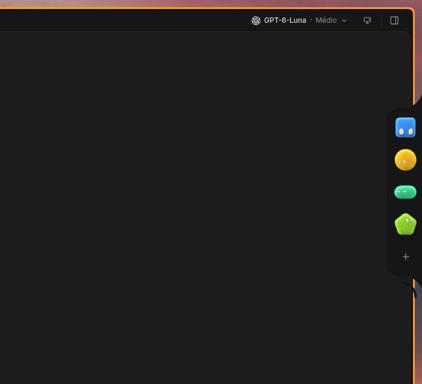
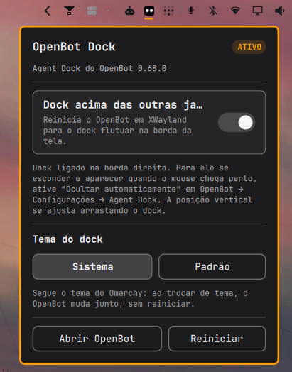
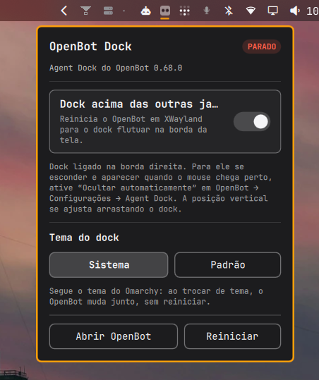
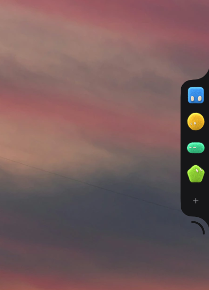
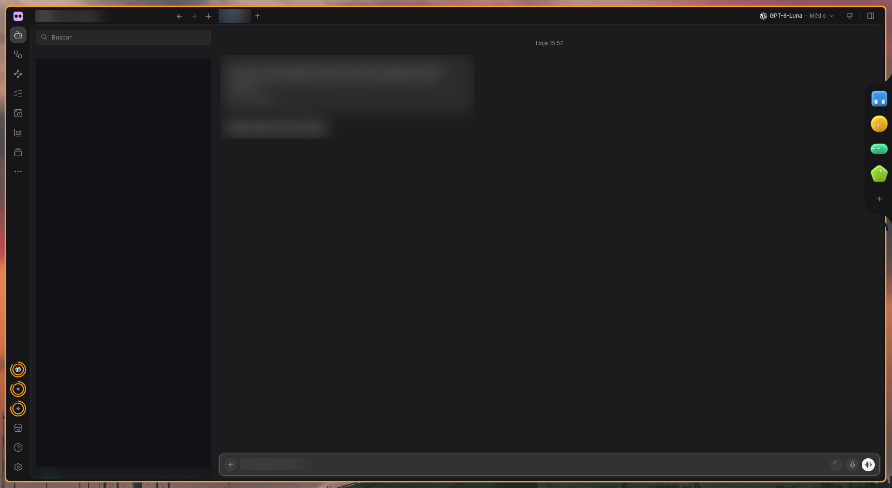

<div align="center">

# OpenBot Agent Dock for Omarchy

**Put the OpenBot Agent Dock on the screen edge, above your windows, macOS-style.**

[English](README.md) · [Português (Brasil)](README.pt-BR.md)


-informational)




</div>

An **Omarchy Shell** bar widget that places the **OpenBot Agent Dock** on the
edge of the screen, over other windows, like the macOS Dock. It reuses the app's
own native dock instead of redrawing one in QML.

The widget shows the OpenBot state in the bar, opens a control panel and
turns the floating dock mode on and off.

> [!WARNING]
> **This plugin works, but it is not finished.** Read
> [Known issues](#known-issues) before installing. In short:
>
> - The dock **can still flash black** when you hover it or when it opens.
> - The dock and the OpenBot window **do not fully follow the Omarchy theme yet**.
> - Clicks on the transparent area around the dock **do not reach the apps below**.
>
> The first and third come from OpenBot itself (XWayland), not from the plugin,
> and can only be fully fixed upstream.

## Contents

- [Screenshots](#screenshots)
- [What it does](#what-it-does)
- [How the dock appears](#how-the-dock-appears)
- [Requirements](#requirements)
- [Installation](#installation)
- [Usage](#usage)
- [Known issues](#known-issues)
- [Project layout](#project-layout)
- [Contributing](#contributing)
- [License](#license)

## Screenshots

| Control panel (running) | Control panel (stopped) |
| :---: | :---: |
|  |  |

| Dock over the wallpaper | Dock next to the OpenBot window |
| :---: | :---: |
|  |  |

<details>
<summary>Full OpenBot window (personal data blurred)</summary>



</details>

> The panel is shown with the Portuguese translation. The interface follows
> the system language (English and Portuguese).

## What it does

- **Official OpenBot icon** in the bar that follows the bar theme: white tile on
  a dark bar (black and blur modes) and black tile on a transparent bar, with a
  smooth transition.
- **Control panel** with: dock above other windows, open OpenBot and restart
  the app.
- **Terminal command** (`openbot-dock-ctl.sh`) with `status`, `open`,
  `dock-on`, `dock-off`, `restart`, `island-off` and `island-on`.
- **Shell IPC** for automation: `omarchy-shell io.github.andrecards.openbot-dock toggle`.
- **Dock theme** switch (System / Default), see [Dock theme](#dock-theme-system-or-default).

## How the dock appears

OpenBot draws the Agent Dock in its own window: transparent and frameless. For it
to behave like the macOS Dock, three pieces are needed, and this project handles
all three:

| Piece | Where it lives | Role |
| --- | --- | --- |
| XWayland marker | `~/.config/OpenBot/agent-dock-xwayland` | Makes OpenBot start under XWayland, which is what lets the dock window stay above other apps. |
| Hyprland rule | `hypr/openbot-dock.lua` | Marks OpenBot's floating windows with `pin`: dock on every workspace, above regular windows. `no_shadow` avoids the compositor shadow around the transparent panel. |
| App preference | OpenBot `localStorage` | Picks right edge, auto-hide and the thin edge strip. |

Auto-hide and the edge strip are native OpenBot options. The plugin turns on the
floating mode; the hide/show behavior belongs to the app.

Careful with window rules on Hyprland 0.56: `no_border` is **not** a valid field
there (it exists only in `workspace_rule`) and makes the compositor reject the
whole rule with `unknown field 'no_border'`, so `pin` is not applied either.

For the full reasoning behind each decision, see
[docs/ARQUITETURA.md](docs/ARQUITETURA.md) (in Portuguese).

## Requirements

- **Omarchy** with Omarchy Shell (Quickshell).
- **Hyprland** with a Lua config (tested on 0.56).
- **OpenBot** installed as an AppImage in `~/.local/share/AppImages/`
  (tested on 0.68.0).
- `jq`, `bash` and `hyprctl`.

## Installation

From the Omarchy plugin marketplace:

```bash
omarchy plugin add https://github.com/andrecards/openbot-agent-dock.git --enable
```

This installs **only the widget**. For the dock to float over windows you also
need the Hyprland rule and the theme hook, which `install.sh` sets up:

```bash
git clone https://github.com/andrecards/openbot-agent-dock.git
cd openbot-agent-dock
./install.sh
```

`install.sh` copies the plugin to `~/.config/omarchy/plugins/io.github.andrecards.openbot-dock`,
installs the Hyprland rule at `~/.config/hypr/openbot-dock.lua`, adds the
`require` to `hyprland.lua` (idempotent) and enables the widget in the bar.

Then restart the shell:

```bash
omarchy restart shell
```

To remove it:

```bash
./install.sh --uninstall
```

## Usage

- **Pointer on the right edge:** the dock slides out.
- **Drag the dock vertically:** adjusts its position (OpenBot stores it per monitor).
- **Click the bar icon:** control panel.
- **Middle-click the icon:** restarts OpenBot.

### Command line

```bash
CTL=~/.config/omarchy/plugins/io.github.andrecards.openbot-dock/openbot-dock-ctl.sh

$CTL status
$CTL dock-on
$CTL dock-off
$CTL restart
$CTL island-off
$CTL island-on
$CTL theme-system
$CTL theme-default
```

### Dock theme: System or Default

In the widget panel, the **Dock theme** row has two buttons:

- **System:** OpenBot (dock and main window) uses the colors of the current
  Omarchy theme. The plugin generates the palette `~/.config/OpenBot/themes/omarchy.json`
  from `~/.local/state/omarchy/current/theme/colors.toml`, and a hook at
  `~/.config/omarchy/hooks/theme-set.d/openbot-palette` regenerates it on every
  theme change. OpenBot watches that folder and is meant to apply the palette
  live, without restarting.
- **Default:** goes back to OpenBot's own dark theme.

Switching between System and Default restarts OpenBot once, because the app
only reads the palette choice at startup.

> [!NOTE]
> The System theme is **experimental** and the result **does not fully match the
> Omarchy theme yet**. See [Known issues](#known-issues).

### OpenBot's Dynamic Island

OpenBot simulates the MacBook notch: a transparent 614×380-point window anchored
to the **top center of the screen**. Linux has no notch, so it sits on top of the
Omarchy bar, covering clock, date and indicators, and because it is transparent
it shows up as a black rectangle with a frame. The app has no position setting:
the top anchor is fixed in its code.

Since the Omarchy bar already shows agent status, the plugin treats the island
as redundant:

```bash
openbot-dock-ctl.sh island-off   # saves the preference and restarts the app
openbot-dock-ctl.sh island-on    # undoes it, back to the app default
```

`status` reports the island state (`island=on|off`).

### IPC

```bash
omarchy-shell io.github.andrecards.openbot-dock toggle
omarchy-shell io.github.andrecards.openbot-dock dock
omarchy-shell io.github.andrecards.openbot-dock refresh
```

## Known issues

### 🟥 Black flash on the dock (still open)

The dock can **still flash black for a moment when you hover it or when it
opens**. It does not break anything, but it is visible. This is a known bug and
it is **not fixed**.

- **Cause:** it is in OpenBot/XWayland, not in the plugin. OpenBot clips the dock
  window with `setShape`. On Hyprland's XWayland, the area outside the clip shows
  black until Chromium repaints.
- **What the plugin can do:** nothing. There is no compositor rule or plugin
  setting that avoids it. The fix has to come from OpenBot.
- **OpenBot 0.68.0** reworked the shape code (`#applyShape`): in our drag test
  (340 events, ~5 captures/s) no black frame showed up, but the flash on hover/open
  still happens.
- While the **"Dock size"** slider is being dragged, the dock also flashes black
  ([nightly-labs/openbot#7780](https://github.com/nightly-labs/openbot/issues/7780)).
  It stops when the slider is released.

### 🟧 Dock theme does not fully follow Omarchy yet

The **System** option generates an OpenBot palette from the current Omarchy theme
and regenerates it on every theme change, but **the dock and the OpenBot window
still do not match the Omarchy theme completely**. Treat the feature as
experimental and expect visual differences from your Omarchy theme.

- The palette generator was tested on all 26 installed themes (light and dark)
  and produces a valid palette for each; the gap is in how OpenBot applies it,
  not in producing it.
- Switching System/Default restarts OpenBot (the app only reads the choice at
  startup).

### 🟧 Clicks on the transparent area do not pass through

**Clicks on the transparent area around the dock do not reach the apps below**
(official OpenBot 0.68.0). The dock window is a fixed 562×512 rectangle, bigger
than the visible part. OpenBot clips only the visible shape on X11, and Hyprland
hands the pointer to the whole XWayland surface.

A fix exists in OpenBot (the dock window shrinks to the dock size when nobody is
using it): in a local fork it raised pointer delivery from 2/6 to 6/6 test points.
It has **not been sent upstream yet**.

### 🟨 Other limitations

- OpenBot's **Dynamic Island** is always created at the top center of the screen
  and the app has no position option. If you use it anyway, it shares space with
  the Omarchy bar; the clean way is to keep it off (`island-off`).
- The dock sits slightly above the vertical center until you drag it: the
  position is an offset that OpenBot stores per monitor.
- Installing from the marketplace gives you **only the widget**. The Hyprland
  rule and the theme hook come from `install.sh`.
- The dock does not exist on native Wayland: OpenBot only creates it under
  XWayland, so the plugin forces the app to start in XWayland.
- Tested **only** on Hyprland with the Lua config and OpenBot 0.68.0 as an
  AppImage. With old `.conf` configs the rule must be converted to `windowrulev2`.
- Cosmetic: in the Portuguese panel, the label "Dock acima das outras janelas"
  is cut off with an ellipsis.

## Project layout

```
manifest.json               plugin manifest (schema 1)
Widget.qml                  bar icon and panel
openbot-dock-ctl.sh         status/open/on/off/restart/theme
openbot-omarchy-palette.py  generates OpenBot's "Omarchy" palette
i18n/                       strings in English and Portuguese
icons/                      OpenBot logo (SVG, light and dark variants)
hypr/
  openbot-dock.lua          window rules (dock and main window)
hooks/theme-set.d/
  openbot-palette           Omarchy hook: regenerates the palette on theme change
docs/
  ARQUITETURA.md            technical decisions and reasons (Portuguese)
  screenshots/              images used in this README
install.sh                  full installer/uninstaller (plugin + rule + hook)
```

## Contributing

See [CONTRIBUTING.md](CONTRIBUTING.md) (Portuguese). Changes are listed in
[CHANGELOG.md](CHANGELOG.md). Since the plugin touches windows, the bar and the
OpenBot app, always test on a real Omarchy/Hyprland session.

## License

MIT, see [LICENSE](LICENSE).
