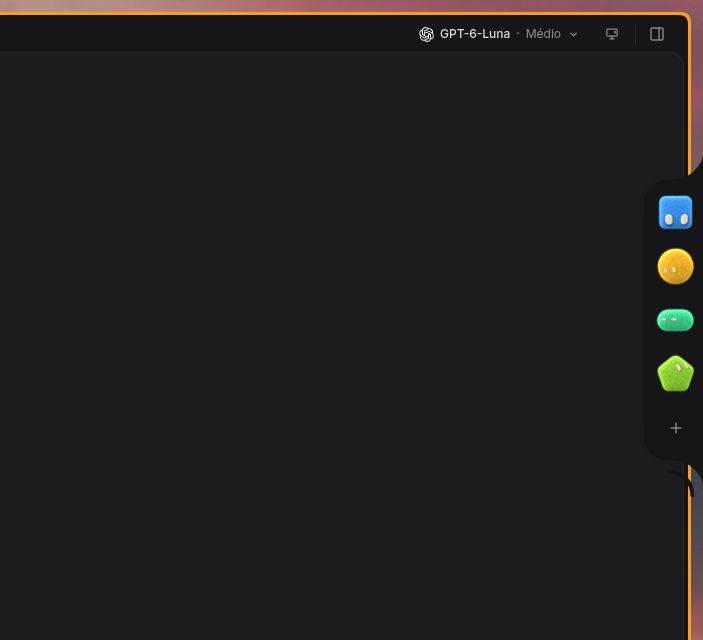
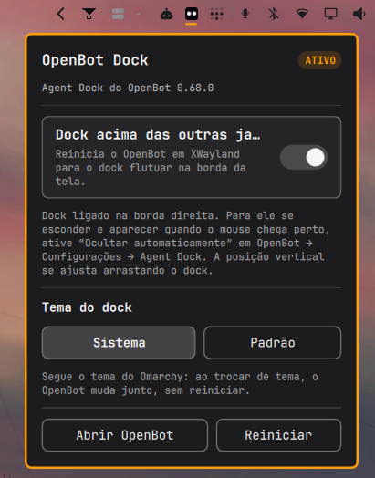
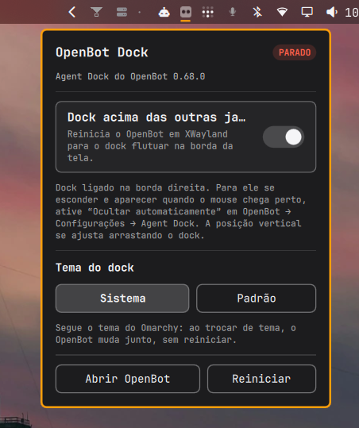
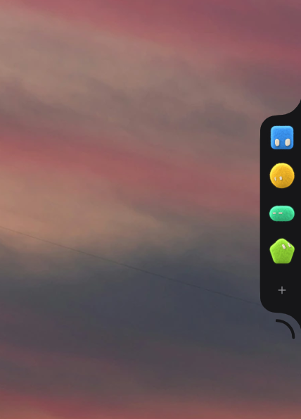
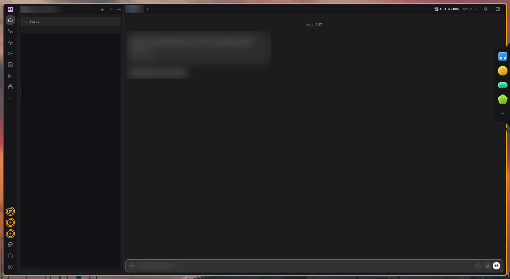

<div align="center">

# OpenBot Agent Dock para Omarchy

**Coloque o Agent Dock do OpenBot na borda da tela, sobre as janelas, no estilo macOS.**

[English](README.md) · [Português (Brasil)](README.pt-BR.md)


-informational)




</div>

Widget de barra do **Omarchy Shell** que coloca o **Agent Dock do OpenBot** na
borda da tela, sobre as outras janelas, no estilo do Dock do macOS. Ele
reaproveita o próprio dock nativo do app em vez de redesenhar um dock em QML.

O widget mostra o estado do OpenBot na barra, abre um painel de controle e
liga/desliga o modo flutuante do dock.

> [!WARNING]
> **O plugin funciona, mas não está terminado.** Leia os
> [Problemas conhecidos](#problemas-conhecidos) antes de instalar. Resumindo:
>
> - O dock **ainda pode piscar em preto** ao passar o mouse ou ao abrir.
> - O dock e a janela do OpenBot **ainda não seguem totalmente o tema do Omarchy**.
> - Cliques na área transparente em volta do dock **não chegam aos apps de baixo**.
>
> O primeiro e o terceiro vêm do próprio OpenBot (XWayland), não do plugin, e só
> podem ser corrigidos por completo no projeto original.

## Sumário

- [Capturas de tela](#capturas-de-tela)
- [O que o plugin faz](#o-que-o-plugin-faz)
- [Como o dock aparece](#como-o-dock-aparece)
- [Requisitos](#requisitos)
- [Instalação](#instalação)
- [Uso](#uso)
- [Problemas conhecidos](#problemas-conhecidos)
- [Estrutura](#estrutura)
- [Como contribuir](#como-contribuir)
- [Licença](#licença)

## Capturas de tela

| Painel de controle (ativo) | Painel de controle (parado) |
| :---: | :---: |
|  |  |

| Dock sobre o fundo de tela | Dock ao lado da janela do OpenBot |
| :---: | :---: |
|  |  |

<details>
<summary>Janela completa do OpenBot (dados pessoais borrados)</summary>



</details>

## O que o plugin faz

- **Ícone oficial do OpenBot** na barra, que acompanha o tema: tile branco em
  barra escura (modo preto e modo blur) e tile preto em barra transparente,
  com transição suave.
- **Painel de controle** com: dock acima das outras janelas, abrir o OpenBot e
  reiniciar o app.
- **Comando de terminal** (`openbot-dock-ctl.sh`) com `status`, `open`,
  `dock-on`, `dock-off`, `restart`, `island-off` e `island-on`.
- **IPC do shell** para automações: `omarchy-shell io.github.andrecards.openbot-dock toggle`.
- **Tema do dock** (Sistema / Padrão), veja [Tema do dock](#tema-do-dock-sistema-ou-padrão).

## Como o dock aparece

O OpenBot desenha o Agent Dock em uma janela própria, transparente e sem
moldura. Para ela se comportar como o dock do macOS são necessárias três
peças, e o projeto cuida das três:

| Peça | Onde fica | Papel |
| --- | --- | --- |
| Marcador XWayland | `~/.config/OpenBot/agent-dock-xwayland` | Faz o OpenBot subir em XWayland, condição para a janela do dock ficar acima dos apps. |
| Regra do Hyprland | `hypr/openbot-dock.lua` | Marca as janelas flutuantes do OpenBot com `pin`: dock em todos os workspaces, acima das janelas comuns. `no_shadow` evita a sombra do compositor em volta do painel transparente. |
| Preferência do app | `localStorage` do OpenBot | Escolhe borda direita, auto-hide e faixa fina na borda. |

O auto-hide e a faixa da borda são opções nativas do OpenBot. O plugin liga o
modo flutuante; o comportamento de esconder/mostrar é do próprio app.

Cuidado com regra de janela no Hyprland 0.56: `no_border` **não** é um campo
válido aí (existe só em `workspace_rule`) e faz o compositor recusar a regra
inteira com `unknown field 'no_border'`, deixando também de aplicar o `pin`.

Todas as decisões e seus motivos estão em [docs/ARQUITETURA.md](docs/ARQUITETURA.md).

## Requisitos

- **Omarchy** com Omarchy Shell (Quickshell).
- **Hyprland** com configuração em Lua (testado na 0.56).
- **OpenBot** instalado como AppImage em `~/.local/share/AppImages/`
  (testado na 0.68.0).
- `jq`, `bash` e `hyprctl`.

## Instalação

Pelo marketplace de plugins do Omarchy:

```bash
omarchy plugin add https://github.com/andrecards/openbot-agent-dock.git --enable
```

Isso instala **só o widget**. Para o dock flutuar sobre as janelas, falta a regra
do Hyprland e o gancho de tema, que o `install.sh` instala:

```bash
git clone https://github.com/andrecards/openbot-agent-dock.git
cd openbot-agent-dock
./install.sh
```

O `install.sh` copia o plugin para `~/.config/omarchy/plugins/io.github.andrecards.openbot-dock`,
instala a regra do Hyprland em `~/.config/hypr/openbot-dock.lua`, adiciona o
`require` no `hyprland.lua` (idempotente) e habilita o widget na barra.

Depois, reinicie o shell:

```bash
omarchy restart shell
```

Para remover:

```bash
./install.sh --uninstall
```

## Uso

- **Ponteiro na borda direita:** o dock desliza para fora.
- **Arrastar o dock na vertical:** ajusta a posição (o OpenBot guarda por monitor).
- **Clique no ícone da barra:** painel de controle.
- **Clique do meio no ícone:** reinicia o OpenBot.

### Linha de comando

```bash
CTL=~/.config/omarchy/plugins/io.github.andrecards.openbot-dock/openbot-dock-ctl.sh

$CTL status
$CTL dock-on
$CTL dock-off
$CTL restart
$CTL island-off
$CTL island-on
$CTL theme-system
$CTL theme-default
```

### Tema do dock: Sistema ou Padrão

No painel do widget, a linha **Tema do dock** tem dois botões:

- **Sistema:** o OpenBot (dock e janela principal) usa as cores do tema atual do
  Omarchy. O plugin gera a paleta `~/.config/OpenBot/themes/omarchy.json` a partir
  de `~/.local/state/omarchy/current/theme/colors.toml`, e um gancho em
  `~/.config/omarchy/hooks/theme-set.d/openbot-palette` a regenera a cada troca de
  tema. O OpenBot vigia essa pasta e deve aplicar a paleta ao vivo, sem reiniciar.
- **Padrão:** volta ao tema escuro do próprio OpenBot.

Trocar entre Sistema e Padrão reinicia o OpenBot uma vez, porque o app só lê a
escolha de paleta ao iniciar.

> [!NOTE]
> O tema Sistema é **experimental** e o resultado **ainda não acompanha por
> completo o tema do Omarchy**. Veja os [Problemas conhecidos](#problemas-conhecidos).

### A Dynamic Island do OpenBot

O OpenBot simula o recorte (notch) dos MacBooks: uma janela transparente de
614×380 pontos ancorada **no topo do centro da tela**. No Linux não existe
notch, então ela fica sobre a barra do Omarchy, cobrindo relógio, data e
indicadores, e, por ser transparente, aparece como um retângulo preto com
moldura. O app não tem ajuste de posição: o topo é fixo no código.

Como a barra do Omarchy já mostra o status dos agentes, o plugin trata a ilha
como redundante:

```bash
openbot-dock-ctl.sh island-off   # grava a preferência e reinicia o app
openbot-dock-ctl.sh island-on    # desfaz, volta ao padrão do app
```

O `status` informa em que estado a ilha está (`island=on|off`).

### IPC

```bash
omarchy-shell io.github.andrecards.openbot-dock toggle
omarchy-shell io.github.andrecards.openbot-dock dock
omarchy-shell io.github.andrecards.openbot-dock refresh
```

## Problemas conhecidos

### 🟥 Piscada preta no dock (ainda aberto)

O dock **ainda pode piscar em preto por instantes ao passar o mouse ou ao
abrir**. Nada deixa de funcionar, mas é visível. É um bug conhecido e **não está
corrigido**.

- **Causa:** está no OpenBot/XWayland, não no plugin. O OpenBot recorta a janela
  do dock com `setShape` e, no XWayland do Hyprland, a área fora do recorte
  aparece preta até o Chromium repintar.
- **O que o plugin pode fazer:** nada. Não existe regra do compositor nem opção
  do plugin que evite isso. A correção precisa vir do OpenBot.
- **OpenBot 0.68.0** refez o trecho que aplica a forma (`#applyShape`): no teste
  de arrastar (340 eventos, ~5 capturas/s) nenhum quadro preto apareceu, mas a
  piscada ao passar o mouse/abrir continua.
- Enquanto o controle **"Tamanho do dock"** é arrastado, o dock também pisca em
  preto ([nightly-labs/openbot#7780](https://github.com/nightly-labs/openbot/issues/7780)).
  Some quando o controle é solto.

### 🟧 O tema do dock ainda não acompanha totalmente o Omarchy

A opção **Sistema** gera uma paleta do OpenBot a partir do tema atual do Omarchy
e a regenera a cada troca de tema, mas **o dock e a janela do OpenBot ainda não
ficam totalmente de acordo com o tema do Omarchy**. Trate o recurso como
experimental e espere diferenças visuais em relação ao seu tema.

- O gerador de paleta foi testado nos 26 temas instalados (claros e escuros) e
  produz uma paleta válida em todos; a diferença está em como o OpenBot aplica
  a paleta, não em gerá-la.
- Trocar Sistema/Padrão reinicia o OpenBot (o app só lê a escolha ao iniciar).

### 🟧 Cliques na área transparente não atravessam

**Cliques na área transparente em volta do dock não chegam aos apps de baixo**
(OpenBot 0.68.0 oficial). A janela do dock é um retângulo fixo de 562×512, maior
que a parte visível. O OpenBot recorta só a forma visível em X11, e o Hyprland
entrega o ponteiro à superfície XWayland inteira.

A correção existe no OpenBot (a janela do dock passa a ter o tamanho do dock
quando ninguém o usa): em um fork local, a entrega do ponteiro subiu de 2 para 6
em 6 pontos de teste. Ela **ainda não foi enviada ao projeto**.

### 🟨 Outras limitações

- A **Dynamic Island** do OpenBot nasce sempre no topo do centro da tela e o app
  não tem opção de posição. Se você usá-la mesmo assim, ela divide espaço com a
  barra do Omarchy; o caminho limpo é mantê-la desligada (`island-off`).
- O dock fica ligeiramente acima do centro vertical até ser arrastado: a
  posição é um deslocamento guardado pelo OpenBot por monitor.
- Instalar pelo marketplace entrega **só o widget**. A regra do Hyprland e o
  gancho de tema vêm do `install.sh`.
- O dock não existe em Wayland nativo: o OpenBot só o cria em XWayland, por isso
  o plugin força o app a iniciar em XWayland.
- Testado **apenas** em Hyprland com config Lua e OpenBot 0.68.0 em AppImage.
  Em configs `.conf` antigas a regra precisa ser convertida para `windowrulev2`.
- Cosmético: no painel em português, o texto "Dock acima das outras janelas"
  aparece cortado com reticências.

## Estrutura

```
manifest.json               manifesto do plugin (schema 1)
Widget.qml                  ícone da barra e painel
openbot-dock-ctl.sh         status/abrir/ligar/desligar/reiniciar/tema
openbot-omarchy-palette.py  gera a paleta "Omarchy" do OpenBot
i18n/                       textos em inglês e português
icons/                      logo do OpenBot (SVG, variantes clara e escura)
hypr/
  openbot-dock.lua          regras de janela (dock e janela principal)
hooks/theme-set.d/
  openbot-palette           gancho do Omarchy: regenera a paleta ao trocar de tema
docs/
  ARQUITETURA.md            decisões técnicas e por quês
  screenshots/              imagens usadas neste README
install.sh                  instalador/desinstalador completo (plugin + regra + gancho)
```

## Como contribuir

Veja [CONTRIBUTING.md](CONTRIBUTING.md). As mudanças estão no
[CHANGELOG.md](CHANGELOG.md). Como o plugin mexe em janelas, na barra e no app
do OpenBot, teste sempre em uma sessão real de Omarchy/Hyprland.

## Licença

MIT, veja [LICENSE](LICENSE).
